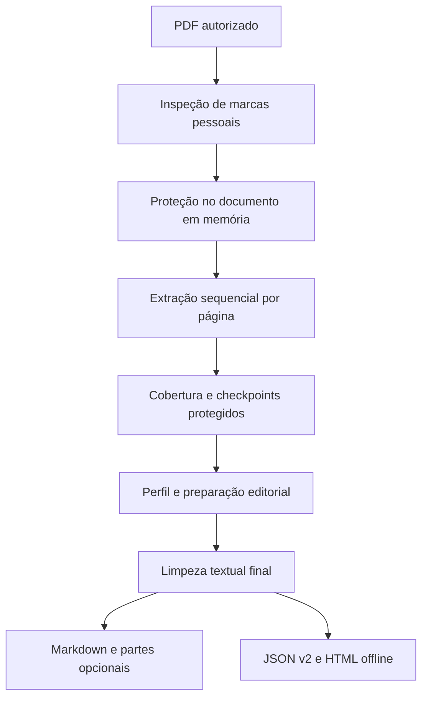

# Arquitetura, recursos e diagnósticos

Referência do estado publicado em **v1.6.2**, commit `d20bcbc` da `main`.
Resultados de testes e distribuição estão em [Distribuição Windows](DISTRIBUICAO_WINDOWS.md).
Este documento descreve o código atual; notas de versões anteriores registram o histórico.

## Camadas e fluxo documental

A interface HTML/CSS/JavaScript se comunica com `BridgeApi` por
`window.pywebview.api`. O backend autoriza arquivos por identificadores opacos,
valida operações e coordena conversão, leitor, editor, acervo e serviços opcionais.

| Componente | Responsabilidade |
|---|---|
| `app.py`, `web_api.py` | Inicialização, janela WebView2, fachada e probe do executável |
| `api_bridge/` | Sete mixins de conversão, leitura, edição, acervo, serviços online, recursos e sistema |
| `converter.py` | Extração por página, cobertura, controle, checkpoints e orçamento de recursos |
| `document_privacy.py` | Reconhecimento de marcas pessoais, redação no documento em memória e limpeza textual |
| `ocr_engine.py` | Detecção de páginas digitalizadas, OCR local e cache por conteúdo |
| `markdown_utils.py` | Finalização, perfil, divisão em partes e publicação dos arquivos |
| `course_editorial.py` | Preparação editorial, evidência da fonte e índice de seções |
| `document_structure.py` | Perfil automático, coleções de questões/gabaritos e comparação do sumário |
| `document_exports.py`, `web/reading-export.*` | JSON v2 e leitor HTML offline |
| `library_db.py`, `app_storage.py` | Acervo, integridade e armazenamento gravável |
| `production_diagnostics.py` | Logs locais, relatório exportável e contadores de sessão |

A conversão não salva sobre o PDF original. O editor é um subsistema separado:
quando o usuário escolhe salvar no original, usa backup e substituição validada.
O perfil automático reconhece numeração hierárquica; escolhas explícitas são
respeitadas. As heurísticas e os limites de IDs, intervalos e transcrição estão no
[contrato estrutural v2](CONTRATO_ESTRUTURAL_V2.md).

## Concorrência, controle e recuperação

O paralelismo ocorre **entre documentos**, em processos isolados. No Windows,
`ConversionMixin` reutiliza pools de um worker em `idle_pools` quando possível.
Não há benchmark atual que sustente uma porcentagem fixa de ganho.

As páginas de cada documento são processadas **sequencialmente**. Não existe
`ThreadPoolExecutor` de páginas no fluxo atual. `page_workers` permanece aceito
por compatibilidade, sem habilitar extração concorrente em threads. Isso mantém
as operações PyMuPDF e a preparação editorial no fluxo previsto pelo conversor.

`ContextVar` mantém os contextos de imagens, perfil e privacidade durante uma
conversão. A saída é remontada na ordem das páginas selecionadas.

O checkpoint contém páginas recuperadas e metadados. O arquivo `control.json`
transmite `pause`, `stop` ou `running`; sua leitura usa cache pelo `st_mtime_ns`.
`status.json` informa o estado confirmado pelo worker. Pausa é observada antes da
próxima página; parada também encerra processos supervisionados pela fila.
Checkpoints incompatíveis com a assinatura/política atual são recalculados.

## Recursos e memória

Os limites de conversão vigentes são definidos em `constants.py`:

| Recurso por PDF | Limite |
|---|---|
| Páginas | 1.000 |
| Arquivo de entrada | 512 MiB |
| Imagens efetivamente extraídas | 25.000 |
| Bytes das imagens extraídas | 512 MiB |
| Memória do processo supervisionado | 1.536 MiB |
| Tempo de conversão | 30 minutos |

O orçamento de imagens considera arquivos efetivamente gravados, não a contagem
prévia de recursos referenciados em cada página. O conversor também verifica
espaço disponível e reduz a concorrência do lote conforme a memória disponível.

Buffers `Pixmap` e de imagem do OCR são desreferenciados em blocos `finally`.
O loop solicita `gc.collect()` a cada 25 páginas ou quando o RSS observado
ultrapassa 250 MiB. Essas medidas não garantem consumo constante para todo PDF;
o watchdog e os limites permanecem ativos.

## OCR, cache e conteúdo visual

O RapidOCR/ONNX executa localmente. `is_blank_pixmap` usa amostragem de pixels
para evitar inferência em imagens uniformes reconhecidas como vazias. A detecção
é heurística, não uma inspeção semântica de toda a página.

O cache é identificado pelo SHA-256 dos bytes da imagem e pelo limiar de score:
memória LRU de até 512 entradas e cache em disco em
`%LOCALAPPDATA%\NexoJuris\Conversor\ocr_cache`. É cache **por conteúdo**, não busca
semântica. Pode conter texto reconhecido e deve ser tratado como dado local do
usuário. Não há garantia de latência fixa para acertos de cache ou OCR.

As marcas reconhecidas são redigidas antes de extrair pixels/OCR. Páginas com
pouco texto nativo, imagem e identificação conhecida no documento podem ter OCR
e imagens omitidos por privacidade. Isso é declarado em `content_kind`,
`visual_status` e avisos, sem chamar uma capa de página vazia. Não há garantia de
anonimização de dados existentes somente dentro de imagens.

## Métricas e diagnósticos

`TelemetryTracker` mantém agregados de sessão sob lock:

- Documentos, páginas, tempo de extração e `pages_per_second`.
- Distribuição `native`, `ocr`, `fallback`, `empty` e `failed`.
- Acertos, falhas e proporção de acertos do cache OCR.
- Maior RSS informado ao coletor, em bytes e MiB.
- Média dos scores lexicais disponíveis, contagem abaixo de 0,85 e páginas com avisos.

`fidelity.avg_score` não mede conformidade semântica. `fidelity_score` combina
recall de tokens, similaridade de ordem e um sinal de Unicode; não certifica
fidelidade jurídica, visual ou estrutural. `null` significa comparação insuficiente
ou indisponível. Consulte a fórmula e a semântica no contrato v2.

Logs persistem em `%LOCALAPPDATA%\NexoJuris\Conversor\diagnostics`, com rotação de
2 MiB e até cinco backups. O relatório exportado sanitiza caminhos e segredos.
Os contadores não incluem texto documental; logs e relatórios devem ser revisados
antes de compartilhar. O diretório pode ser isolado com `NEXOJURIS_DATA_DIR` em testes.

## Build e validação

`npm ci` seguido de `npm run build:web` recompila os recursos locais usando
Tailwind e CLI 4.3.3. A entrada CSS carrega explicitamente a configuração e os
arquivos da interface; não depende de CDN. O override de `@parcel/watcher` 2.6.0
remove a cadeia de dependências vulneráveis observada na preparação da release.

`build_support.py` implementa o build PyInstaller de Conversor e Admin em pastas
separadas. A etapa opcional Cython pode compilar extensões em posição junto aos
módulos; a limpeza é executada ao finalizar. O Admin privado não acompanha o
instalador público, e chaves privadas não integram a distribuição.

Na v1.6.2, 338 testes Python, os seis arquivos de testes JavaScript, Ruff, build
web e gates de pacote/instalador foram aprovados. O CI executa Linux e Windows;
a compilação Inno Setup e seu gate foram executados localmente. Os comandos e
as evidências reproduzíveis estão no [guia de distribuição](DISTRIBUICAO_WINDOWS.md).
